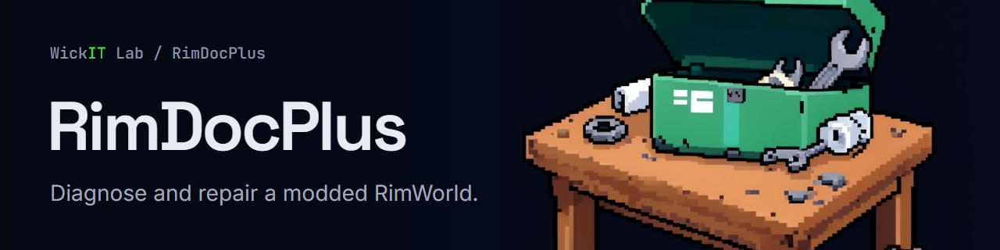

<p align="center">
  
</p>

**Diagnose, repair, and supervise a modded RimWorld install**

RimDoc+ is a desktop companion for large RimWorld mod lists. It reads your install, proves what will break before you press Play, supervises the game while it runs with a structured live log, and turns the wreckage of a crash into a ranked list of causes with repairs attached. Where a mod manager answers "what order do these load in", RimDoc+ answers "why is my colony throwing 40,000 red errors and which of my 253 mods did it".

It is a Tauri v2 desktop app (Rust + React + TypeScript) with a .NET sidecar for assembly inspection and a small companion RimWorld mod for per-mod tick timing. The parsing and diagnostic layers are pure TypeScript, so the whole rules engine runs headless under `vitest` against fixtures captured from a real install, and the same UI runs in a browser preview on a fixture.

> **Design rule:** RimDoc+ never edits a mod in place. Every repair is either an overlay mod that loads after the target or a derived copy in the vault with a diff attached, so the original stays pristine and every change is one click from reverted. Fixes are distributed as recipes applied to your own copy, never as redistributed mod files.

## Contents

- [Tech stack](#tech-stack)
- [Prerequisites](#prerequisites)
- [Getting started](#getting-started)
- [Features (built)](#features-built)
- [How the repair tiers work](#how-the-repair-tiers-work)
- [Documentation](#documentation)
- [Security](#security)
- [What's not yet built](#whats-not-yet-built)
- [License](#license)

## Tech stack

| Layer               | Technology                            | Why                                                                                      |
| ------------------- | ------------------------------------- | ---------------------------------------------------------------------------------------- |
| Shell               | Tauri v2 (Rust)                       | Native filesystem access, process supervision, small binary                              |
| UI                  | React 19 + TypeScript + Vite          | One UI for the desktop app and the browser preview                                       |
| Analysis            | Pure TypeScript                       | Runs in the browser preview and headless under vitest, no Rust round trip to test a rule |
| Assembly inspection | .NET sidecar (Mono.Cecil)             | Harmony target resolution needs the real .NET metadata reader                            |
| Telemetry           | Companion RimWorld mod (C# + Harmony) | The only way to get per-mod tick attribution from inside the running game                |
| Tests               | vitest, `cargo test`, `dotnet test`   | Rules and parsers run against fixtures; the shell and the probe have their own suites    |

The split is deliberate: Rust does IO, hashing, and process control; TypeScript does parsing and rules; C# does anything that has to understand a .NET assembly.

## Prerequisites

- Node 22.19+ (see `.nvmrc`) and pnpm 10
- Rust stable, 1.77 or newer, plus the [Tauri v2 prerequisites](https://v2.tauri.app/start/prerequisites/) for your platform (for the desktop shell)
- .NET 10 SDK (for the assembly sidecar and the companion mod; the app runs without them and says so)
- A RimWorld install to point it at (the browser preview runs on a fixture without one)

The packaged releases are Windows only. The Steam and process handling in the desktop shell uses `steam.exe`, `tasklist`, `reg` and `taskkill`.

## Getting started

### Install a release

Download the latest installer from the [Releases page](https://github.com/w1ck3ds0d4/RimDocPlus/releases/latest): an NSIS `-setup.exe` or an `.msi`. The installers are unsigned, so Windows SmartScreen warns on first run: click **More info**, then **Run anyway**.

### Run from source

1. Install dependencies and read your local install into dev fixtures:

   ```bash
   pnpm install
   pnpm scan          # auto-detects Steam install locations and the save-data folder
   ```

   Pass a specific log with `pnpm scan --log path/to/Player.log`. The fixtures land in `src/dev-data/`, which is gitignored because they describe one machine's install. Without them the UI renders an empty state telling you to run the scan.

2. Start the browser preview at `http://localhost:1420`, and run the headless rules and parser tests:

   ```bash
   pnpm dev
   pnpm test
   ```

3. Run or build the desktop app:

   ```bash
   pnpm tauri:dev     # desktop app against the dev server
   pnpm tauri:build   # release binary and installers
   ```

4. Optional, to fetch Workshop metadata (the opt-in network step; results cache for a week):

   ```bash
   pnpm workshop           # fetch anything missing or older than a week
   pnpm workshop --force   # refetch everything
   ```

5. Optional, to enable the Harmony check and per-mod tick timing, build and stage the sidecar and the companion mod:

   ```bash
   pnpm probe:build        # dotnet publish of the patch probe
   pnpm probe:stage        # copy it where Tauri expects a sidecar
   pnpm probe:verify       # trimmed and untrimmed builds must report the same thing
   pnpm probe-mod:build    # the companion RimWorld mod
   pnpm probe-mod:stage
   ```

6. Before opening a pull request, run `pnpm verify` (types, tests, formatting) and `cargo test --manifest-path src-tauri/Cargo.toml`. See [CONTRIBUTING.md](CONTRIBUTING.md) for the rest of the checks.

## Features (built)

### Install scan and library

- Walks the official `Data` folder, local `Mods`, and the Steam Workshop content folder
- Tolerant `About.xml` reader that survives the malformed files a strict XML parser rejects: stray ampersands, mid-file BOMs, unclosed tags, inconsistent casing
- Resolves each mod's own `packageId` even when the file declares `<modDependencies>` above its own identity
- Detects compiled assemblies and XML patch folders, including payloads under a version folder such as `1.6/Assemblies`
- Cross-references `ModsConfig.xml` to mark active mods and their load position
- Live scanning in the desktop build: a **Rescan** button, plus an automatic rescan after any repair that touched disk. The Rust scanner is a port of `scripts/scan.mjs`, validated by diffing every field of both against the same 252-mod install. Both skip `.rimdocbak` backups so a repair never makes the next scan report what it just resolved
- A **Library** table of every installed mod, sortable by dependents, decoded texture cost, disk size, Workshop subscribers and favorites, and days since the author updated it
- **Cleanup candidates**: enabled mods with real texture weight that nothing depends on. A shortlist to look at, not a recommendation
- **Mod details** for any mod: its own banner from `About/Preview.png`, author, package id, source, load position, advertised game versions, cost (disk, textures, texture memory, patch operations), what it needs, what depends on it, what it conflicts with, and the findings that name it. Relationships are jumps to that mod; a declared but missing mod stays visible and inert

### Home

- A one-line verdict colored by severity, with blocking findings, warnings, faults from the last session and texture memory, each a way into the tab that explains it
- **What RimDoc+ did**: a journal of every repair applied, load order written and rollback run
- **What changed in your mods**: added, removed and updated since the previous scan, from folder modification times, stored against the scan that produced it
- **What's new in RimDoc+**: the app's own release notes

### Doctor (static analysis)

Independent rules, each provable without launching the game:

- **orphan-active**: enabled package ids with no folder on disk
- **duplicate-package-id**: the same id in two folders, where RimWorld silently picks one
- **dlc-after-mods**: official expansions loading behind third-party content
- **bootstrap-position**: Prepatcher or Harmony loading after a mod that ships C#
- **missing-dependency** and **inactive-dependency**: separated, because one needs an install and the other needs a click
- **incompatible-pair**: both mods enabled where one declares the conflict
- **load-order-violation**: `loadAfter` and `loadBefore` constraints the current order breaks
- **load-last-position**: a mod that asks to load last but has many mods behind it
- **duplicate-defs**: a mod that declares nothing another mod does not already declare
- **version-mismatch**: mods not advertising the running game cycle, collapsed into one counted finding
- **bundled-assemblies**: two or more mods shipping the same library; reported, never repaired, since removing a bundled library is the author's call
- **workshop-updates**: mods the Workshop has updated more recently than the copy on disk (needs `pnpm workshop` data)
- **patch-override**, **oversized-textures** and **texture-footprint**, described under XML patch analysis and Performance below
- **Harmony patch check**: see below

Every finding carries a proposed repair tagged with its tier and whether it can be applied automatically. The severity counts above the list are filters. The doctor analyses the modpack you are editing, not the load order the game happens to hold, so toggling a mod updates the findings immediately. See [docs/HOW-IT-WORKS.md](docs/HOW-IT-WORKS.md) for each rule in detail.

### Harmony patch check

When RimWorld updates, methods get renamed, moved or deleted, and a Harmony patch aimed at one that has gone cannot apply. **Check Harmony patches** on the Doctor tab reads the assemblies of every code mod in your modpack and resolves each declared patch target against the installed game. It reads .NET metadata and never loads an assembly, so nothing in any mod runs.

- One finding per mod rather than per patch; where a method moved, it says where to
- A patch class with a Harmony `Prepare()` is reported separately, since it may skip a missing target on purpose
- Patches whose target is built in code (`TargetMethod()`, `harmony.Patch(...)`) are counted and reported as unchecked rather than passing silently

See [sidecar/README.md](sidecar/README.md) for the probe itself, which runs standalone against any install.

### XML patch analysis

The scanner reads every mod's `Patches` folder, including the versioned `1.6/Patches` layout, and extracts each xpath-targeting operation, nested ones included. Collisions are reported per pair of mods, only when at least one side overwrites rather than adds, and the finding names which mod wins by load order.

Overrides are explained rather than flagged, because overwriting is how RimWorld content layers. Each one is a note with its evidence quoted: **declared** (the later mod lists `loadAfter` or depends on the other), **documented** (its description says where to load it), **content** (its name or description reads as layered content), or **assumed**. Nothing here proposes a reorder.

### Session report (log intelligence)

- Filters Unity's fallback-handler noise, which is most of what makes a RimWorld log unreadable
- Clusters identical faults by fingerprint, so 40,000 repeats of one NullReference become one row with a count
- A full stack trace on every fault, with engine plumbing dimmed and mod frames highlighted
- Attributes each fault to a mod by matching stack-frame namespace roots and inline tokens against the scanned mod list
- Reads Harmony patch annotations (`- POSTFIX ModName: ...`) out of the trace and lists each patch above it with its kind, method and owning mod; a transpiler is marked differently from a prefix or postfix
- Explains recognised conditions in plain language: ghost Workshop subscriptions, duplicate loads, settings-constructor failures, failed XML patches, unresolved cross-references, broken vsync, refresh-rate drift
- Detects the mod-config reset, where a failed load makes RimWorld rewrite `ModsConfig.xml` back to Core only
- Scrapes the environment header (game build, Unity version, GPU, VRAM, driver) and ranks startup phase costs
- **Findings the scan has settled**: where the current scan can show that a fault is fixed (a duplicate with one copy left, a ghost subscription whose mod has arrived, a mod list that is populated again), the finding moves to a note with its reason. Nothing else is settled, because silence is not proof
- **Share a session**: the environment, the clustered faults with what each was blamed on, and the active mod list, small enough to paste into a forum (252 lines and 12.8 KB on the reference install). Copied or saved, never sent

### Modpacks and load order

- A modpack is a named, saved mod list in load order. Create from the game's current setup or start minimal; duplicate, rename and delete
- A drift indicator per modpack shows what it adds, removes and reorders relative to what the game currently runs
- Export as `ModsConfig.xml` or as a portable `.rimdoc.json`
- Dependents count per mod: how many enabled mods declare it. That is the difference between a mod you can drop and one that takes fifty others with it
- Enable and disable individually or in bulk across a filtered set; enabling inserts at a defensible position so a framework lands ahead of what depends on it
- **Auto-sort**: a stable topological sort putting bootstrappers first, then Ludeon content in canonical order, then everything else resolved against `loadAfter`, `loadBefore`, `forceLoadAfter`, `forceLoadBefore` and dependency constraints. Ties keep their current position so the diff stays reviewable, and constraint cycles keep their existing order
- Filter by name or package id, tagged by source and by whether the mod ships C# or XML patches

### Repairs and triage

Every finding with a repair explains its plan before anything happens; the button reveals what would change, and only the plan carries the action.

- **Modpack repairs** apply instantly and are fully undoable, because a modpack is app state: drop orphan entries, enable a dependency, reorder to satisfy constraints
- **Choice repairs** refuse to guess but still reason. A duplicate install is ranked on version support, local pins, update recency and subscriber count, and the suggested copy says why; when the signals disagree, the disagreement is printed
- **File repairs** list every path they would touch and generate a PowerShell script that backs up each file first
- **External repairs** (resubscribing to a Workshop item) link straight to the right page
- An **Auto** toggle: off, anything ambiguous is a modal question with a Recommended answer and its reasoning; on, the app answers using the same reasoning and records what it decided. Auto never touches disk unasked: a decision that removes files is staged into the repair script, which you read and run yourself
- **Fix all automatic** applies every deterministic modpack repair in one batch, each planned against the previous result, undone as a unit
- **Triage** assesses everything, applies what is provably safe as one undoable step, and stages the rest: needs your decision, needs a script (one PowerShell script, deduplicated), needs you (Workshop and OS settings, with links), and no repair yet. The resolved count comes from re-running the rules against the repaired modpack, and Triage does not claim the game runs
- A streaming repair console with a wall-clock estimate for staged file work (a throughput model of 30 ms per file plus 15 ms per megapixel, validated within 1% on a 30-file sample)
- Anything that cannot be undone asks first; Escape cancels and Enter is deliberately unbound

### Backups and rollback

Nothing is changed before a copy exists.

- On first scan RimDoc+ records the load order as found and never overwrites that record; **Restore original load order** appears only once a modpack has diverged from it
- Every generated script copies the save-data `Config` folder to `~/RimDoc-Backups/original-version` once, then copies each file it will change into a timestamped `run-*` folder so one run can be undone as a unit
- Individual files get a `.rimdocbak` alongside them
- Every repair plan also generates a rollback script that lists exact paths, reports what it restored and skipped, and is safe to run twice

### Performance

Measured from the files on disk, not estimated.

- **Texture footprint**: PNG headers are read and summed as width x height x 4, since Unity uploads textures decoded and on-disk compression buys nothing at runtime
- **Oversized textures**: everything at 1024px or larger, named per mod
- **Downscale repair** (tier 3): resizes to a maximum dimension preserving aspect ratio, with a before/after figure per texture, backed up first and never run automatically. On the 253-mod install this was built against, 729 oversized textures cost 4.20 GB and resizing to 512px brings that to 0.60 GB
- **Per-mod tick cost**: the companion mod times each mod's code per tick from inside the running game and reports it on the Performance tab

### Running and judging the game

- **Play and watch** starts RimWorld and streams its log as it is written, then reports exit code, duration, lines written and the faults found by the Session analysis. The log is followed from where it stands at launch, because RimWorld truncates `Player.log`. A run that goes quiet for 90 seconds while alive is called out, never killed on a guess
- **Run classification**: a run is judged from the markers it wrote, taken from real failed and successful logs. RimWorld's own reset-to-Core admission is the decisive failure; reaching mod construction is success, which means the mod list loaded, not that the game is playable. Anything else is reported as unknown
- **Measured runs**: every watched run records startup phases, wall clock, peak working set and faults, and two runs can be compared side by side. All of it is measured from outside the process; there is no frame rate or tick rate in this section on purpose
- **Saves**: each save's own mod list is compared with the current load order, distinguishing installed-but-disabled from not installed, naming mods removed since from the save's own record. Only the head of each file is read (20 KB of a 102 MB save on the reference install); `.rws.old` backups are skipped

### Find the culprit

For a crash or slowdown nothing on disk explains: half the mods are switched off, the order is written into the game and the game is started. You say whether the problem is still there and the list halves again; a 224-mod list settles in about eight launches. Every verdict is yours.

- Official content and the bootstrap layer are never switched off, and every dependency of a kept mod is pulled back in, but a mod pulled in that way stays a suspect
- The search is saved on every step, and the original load order is restored when it ends, however it ends
- Where the run can judge itself (a fault that stops the mod list loading), a trial stops the game as soon as the verdict lands, and only a game it started
- It cannot find a fault that needs two particular mods together, and says so up front

### Exact builds and the vault

- **Pinning** records the content hash of every mod in a modpack; checking re-reads them and reports drift when Steam has replaced a mod underneath a setup
- The vault stores the copies a pin refers to, addressed by file contents and paths (sorted) rather than by the version in `About.xml`. `.rimdocbak` backups and Steam's `PublishedFileId.txt` are excluded from the identity. Vaulting a build already held costs one walk and no copy
- Restoring backs up what it replaces, and a drifted mod can only be restored when its pinned build is in the vault

### Retry a download

For a mod that arrived damaged rather than absent. It drops Steam's installed record for the item while keeping the subscription, and removes the mod folder, which makes Steam fetch it again. The manifest edit and the folder delete move together, and both are backed up first.

- Steam rewrites its manifest on exit, so the repair needs Steam closed. **Close Steam, apply, start it again** does all three, using Steam's own shutdown, and refuses outright if Steam is running a game (read from `RunningAppID`)
- **Apply the rest now** applies everything that does not need Steam closed and names what it held back
- Offered on any Workshop mod from its detail panel and on the ghost-subscription finding

### Desktop shell

In the browser RimDoc+ analyses and plans; the desktop build also carries plans out.

- **Apply to game** writes the modpack's load order into `ModsConfig.xml`, backing up the current file first
- **Play** starts RimWorld from its install folder
- **Apply directly** runs a repair plan natively (metadata stamps, config writes, folder removals, texture downscaling) with an original-version backup taken first. One failing action does not abort a run; it is reported against its own target
- **Undo this run** restores every backup the run made

The same plan object drives all three executors, and shell-only actions render disabled with the reason rather than being hidden in the browser build.

### Settings and developer mode

- **Developer mode** opens a diagnostics panel: self-checks about RimDoc+ itself (unique finding ids, every proposed fix names a repair that exists, no empty rows), a captured console with repeats collapsed, per-rule output and timing (rules run isolated, so a throwing rule is recorded and skipped), parse counts, and suspicious zeroes flagged red. An orange strip marks the mode as on
- **Reset the app** clears everything RimDoc+ remembers so the next start is a first one. It leaves your install, repair backups and the vault alone
- A render crash shows the error and component stack rather than a blank page

## How the repair tiers work

Repairs are graded by how much machinery they need and how much can go wrong. See [docs/SPEC.md](docs/SPEC.md) for the full model.

| Tier | Scope                                                                                             | Risk                         |
| ---- | ------------------------------------------------------------------------------------------------- | ---------------------------- |
| 1    | Metadata and load order: version stamps, ordering, enabling a dependency                          | Near zero, fully reversible  |
| 2    | XML patch repair: rewriting a stale xpath, quieting a failed operation, resolving a def collision | Low, diffed before apply     |
| 3    | Missing content: stub defs for absent dependencies, texture path and casing fixes                 | Moderate, changes what loads |

## Documentation

| Document                                         | What is in it                                                                                                            |
| ------------------------------------------------ | ------------------------------------------------------------------------------------------------------------------------ |
| [docs/ARCHITECTURE.md](docs/ARCHITECTURE.md)     | How the pieces fit: the layer split, why repairs are plans rather than actions, the command surface, and the module map. |
| [docs/HOW-IT-WORKS.md](docs/HOW-IT-WORKS.md)     | What each individual analysis actually does, rule by rule.                                                               |
| [docs/SECURITY-MODEL.md](docs/SECURITY-MODEL.md) | Everything this app can touch, with the source that enforces each limit.                                                 |
| [docs/SPEC.md](docs/SPEC.md)                     | The original specification, including what is planned and not yet built.                                                 |
| [docs/SMOKE-TEST.md](docs/SMOKE-TEST.md)         | The list a person works down before a release, ordered so what writes to your game comes last.                           |
| [sidecar/README.md](sidecar/README.md)           | The patch probe: what it reports and how to run it by hand.                                                              |
| [CONTRIBUTING.md](CONTRIBUTING.md)               | Building it, the checks that must pass, and the house style.                                                             |
| [CHANGELOG.md](CHANGELOG.md)                     | Release history.                                                                                                         |
| [ROADMAP.md](ROADMAP.md)                         | What is being built next.                                                                                                |

## Security

RimDoc+ deletes folders inside your game install when you ask it to repair one, so what it can touch is written down in [docs/SECURITY-MODEL.md](docs/SECURITY-MODEL.md), with the source that enforces each limit.

- The webview cannot touch the filesystem. It can only call the commands registered in `src-tauri/src/lib.rs`, and five of them write
- It writes to your RimWorld install, its config folder, and two folders in your home directory (`~/RimDoc-Backups` and `~/RimDoc-Vault`)
- Every file is copied to `<file>.rimdocbak` before it changes, and every run is undoable
- There is no telemetry, analytics or crash reporter. The app is offline by default
- Two things reach the network, both on request: `pnpm workshop` sends a list of public Workshop file ids to Steam's anonymous `GetPublishedFileDetails` (no account, key or credential; results cache for a week; the app works fully without it), and **Fetch** retrieves a shared log from a gist link you pasted
- The patch probe reads .NET metadata and never loads an assembly, so no mod code runs during a check
- A CI security scan runs on every pull request and push to main

## What's not yet built

- **Unattended reproduction of a fault that needs a colony**: trials are launched and judged rather than run unattended, and a slowdown is still yours to call
- **Stub defs beyond SoundDef**: an empty def is only safe to stand in for where the absence degrades rather than breaks, which today is one type
- **Scripted soak run**: a long unattended session with faults attributed over time
- **Frame measurement**: load time, memory and per-mod tick cost are measured; frame time is not attributable to a mod by timing ticks
- **Fix registry**: shared, signed repair recipes keyed on package id, mod version and game version, with mod-author consent and an upstream export path
- **Def audits**: unreachable def pruning
- **XML patch simulation**: running every `PatchOperation` against the merged def database to report which xpaths will miss, without launching the game (see [ROADMAP.md](ROADMAP.md))
- **Session capture on abnormal exit**: a bundled case file (log, mod list, save, system specs, crash dump), also on the roadmap
- Signed installers; releases are currently unsigned

## License

This project is dual-licensed:

- [AGPL v3](LICENSE) - free for open-source use. Derivatives and SaaS deployments must release their source under AGPL.
- [Commercial license](COMMERCIAL.md) - for proprietary / closed-source use or hosted services that do not want to comply with AGPL source-disclosure requirements. Contact support@wickitlab.com for terms.

RimDoc+ is an unofficial community tool. It is not affiliated with or endorsed by Ludeon Studios.
